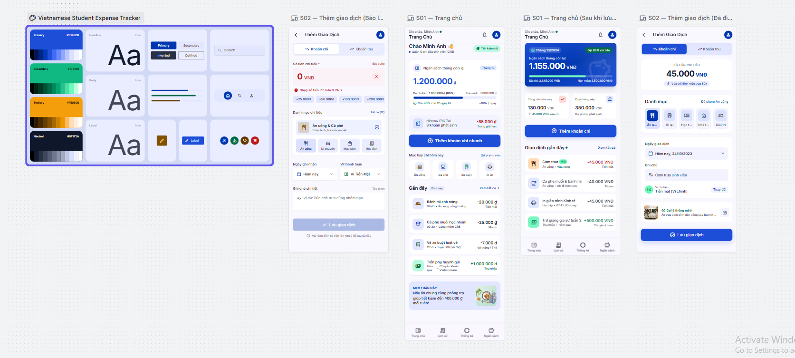
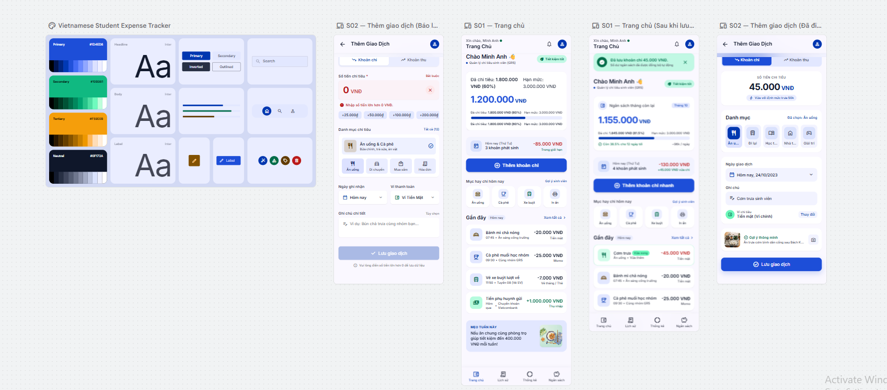
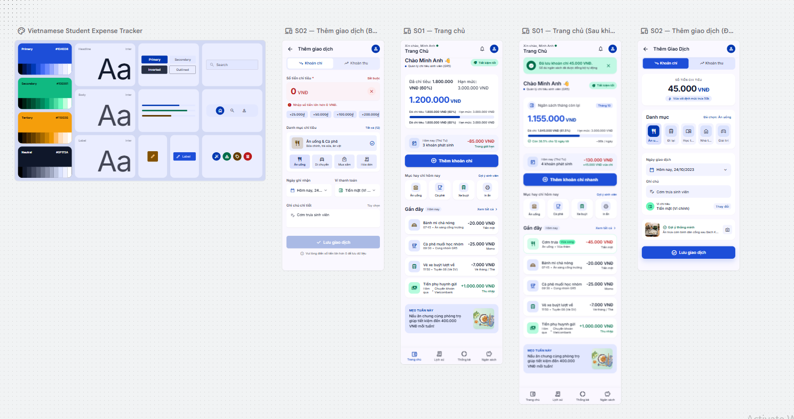
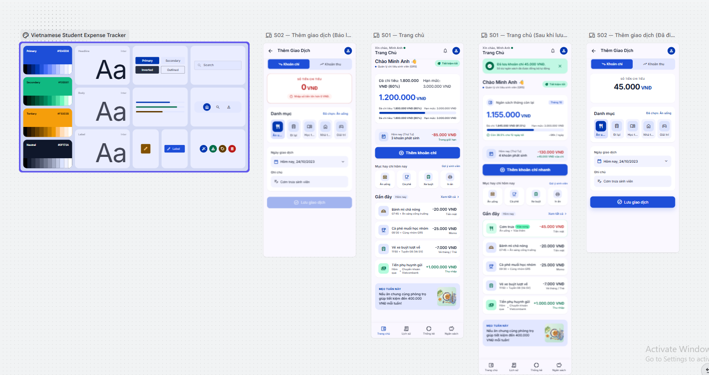

# Nhật ký thiết kế với AI — Expense Tracker

**Lab 2 · Nhóm GR5 · Công cụ tạo giao diện: Google Stitch**

Brief thiết kế [DESIGN.md](../design/DESIGN.md) · Luồng người dùng [user-flow.md](../ux/user-flow.md)

## 01 — Bản dựng đầu tiên

Mục tiêu của lượt này là dựng luồng UF-01 cho Minh Anh (P01), từ Trang chủ đến Thêm giao dịch rồi quay về Trang chủ với ngân sách đã cập nhật.

### Prompt đầu tiên

Đây là prompt đã chuẩn bị trong cuộc trò chuyện. Nếu nội dung thực tế gửi vào Stitch khác, thay khối dưới đây bằng bản sao nguyên văn từ lịch sử Stitch.

```text
Thiết kế hai màn hình mobile bằng tiếng Việt cho Expense Tracker, nhóm GR5.
Người dùng chính là Minh Anh, sinh viên cần ghi nhanh khoản chi ngay sau khi
thanh toán. Mục tiêu là tự lưu khoản ăn trưa 45.000 VNĐ trong tối đa 15 giây.

Dùng khung 390 × 844, bố cục một cột, font Inter, nền #F8FAFC, thẻ trắng
và nút chính #1D4ED8 với chữ trắng. Lề ngang 16 dp, khoảng cách giữa
các nhóm 24 dp, bo góc thẻ 16 dp, bo góc nút và ô nhập 12 dp.
Vùng chạm tối thiểu 48 × 48 dp.

S01 — Trang chủ
- Đặt thẻ “Ngân sách tháng còn lại” ở đầu màn hình, hiển thị 1.200.000 VNĐ.
- Hiển thị tổng chi hôm nay và đặt nút “Thêm khoản chi” ngay sau phần tổng quan.
- Thanh điều hướng dưới gồm Trang chủ, Lịch sử, Thống kê, Ngân sách.
  Đánh dấu Trang chủ là mục đang chọn.

S02 — Thêm giao dịch
- Có nút Quay lại và mở sẵn loại “Khoản chi”.
- Có ô Số tiền với hậu tố VNĐ, ô chọn Danh mục, ngày mặc định là hôm nay
  và ô Ghi chú tùy chọn.
- Nút chính là “Lưu giao dịch”. Dùng dữ liệu mẫu 45.000 VNĐ và danh mục
  “Ăn uống” để minh họa trạng thái đã điền.
- Tạo thêm biến thể lỗi khi số tiền bằng 0. Hiện “Nhập số tiền lớn hơn
  0 VNĐ.” ngay dưới ô Số tiền và giữ danh mục “Ăn uống” đã chọn.

Tạo thêm biến thể S01 sau khi lưu, hiển thị thông báo
“Đã lưu khoản chi 45.000 VNĐ.” và ngân sách còn lại là 1.155.000 VNĐ.
```

### Kết quả Stitch trước khi chỉnh sửa



| Khung | Kết quả quan sát được |
|---|---|
| Bảng style | Có màu chính #1D4ED8, mẫu chữ Inter và mẫu component. |
| S01 trước khi lưu | Hiển thị ngân sách còn lại 1.200.000 đ và nút xanh “Thêm khoản chi nhanh”. |
| S02 đã điền | Hiển thị 45.000 VNĐ, danh mục Ăn uống và nút “Lưu giao dịch”. |
| S02 báo lỗi | Số tiền bằng 0, lỗi hiện ngay dưới ô nhập và nút lưu hiển thị ở trạng thái mờ. |
| S01 sau khi lưu | Hiển thị 1.155.000 VNĐ và giao dịch “Cơm trưa” −45.000 VNĐ. |

### Nhận xét và quyết định cho lượt tiếp theo

| Phát hiện từ ảnh | Quyết định dự kiến | Lý do |
|---|---|---|
| S01 trước và sau khi lưu có bố cục khác nhau. Hạn mức đổi từ 3.000.000 thành 3.500.000 VNĐ. | Dùng cùng một bố cục và giữ hạn mức 3.000.000 VNĐ. Đã chi tăng từ 1.800.000 lên 1.845.000 VNĐ. | Người dùng dễ đối chiếu khoản vừa ghi. Số dư giảm đúng 45.000 VNĐ. |
| S01 sau khi lưu có giao dịch mới, chưa thấy thông báo xác nhận theo brief. | Hiện “Đã lưu khoản chi 45.000 VNĐ.” khi quay về Trang chủ. | Người dùng biết thao tác đã hoàn tất. |
| Hai khung S02 khác bố cục và dùng nhãn danh mục “Ăn uống” và “Ăn uống & Cà phê”. | Dùng một bố cục cho cả hai trạng thái, giữ nguyên danh mục “Ăn uống” khi báo lỗi. | Người dùng chỉ cần sửa số tiền rồi lưu lại. |
| Stitch thêm ví thanh toán, gợi ý thông minh và nút cộng nhanh vào S02. | Giữ các trường Số tiền, Danh mục, Ngày giao dịch, Ghi chú và nút Lưu giao dịch trong bản thử UF-01. | Giảm nội dung cạnh tranh với thao tác ghi nhanh. |
| S01 dùng cả “đ” và “VNĐ”, tên nút chính thay đổi giữa hai khung. | Dùng “VNĐ” và “Thêm khoản chi” nhất quán. | Cùng một hành động và đơn vị có cùng cách hiển thị. |

Ảnh cho phép đối chiếu bố cục và số liệu hiển thị. Thao tác lưu, giữ dữ liệu khi lỗi và mục tiêu 15 giây sẽ được kiểm tra trên prototype đã nối luồng.

## 02 — Lượt chỉnh sửa 1

**Mục tiêu** — Đồng nhất hai trạng thái Trang chủ.

**Ảnh trước** — [Bản dựng đầu tiên](../assets/stitch/00-initial-stitch.png).

**Prompt đề xuất**

```text
Chỉnh hai khung S01 Trang chủ để dùng cùng bố cục, thành phần, màu sắc và
vị trí nút “Thêm khoản chi”. Dùng hạn mức 3.000.000 VNĐ ở cả hai trạng thái.
Trước khi lưu, hiển thị đã chi 1.800.000 VNĐ và còn lại 1.200.000 VNĐ.
Sau khi lưu, hiển thị đã chi 1.845.000 VNĐ và còn lại 1.155.000 VNĐ.
Thêm giao dịch Cơm trưa thuộc Ăn uống, −45.000 VNĐ, vào đầu danh sách
giao dịch gần đây và hiện “Đã lưu khoản chi 45.000 VNĐ.”.
Giữ nguyên thanh điều hướng dưới và dùng VNĐ cho tất cả số tiền.
```

### Ảnh sau và kết quả đối chiếu



- **Đã đạt về dữ liệu.** Hai trạng thái giữ hạn mức 3.000.000 VNĐ. Đã chi tăng từ 1.800.000 lên 1.845.000 VNĐ, còn lại giảm từ 1.200.000 xuống 1.155.000 VNĐ.
- **Đã đạt về phản hồi hiển thị.** Trang chủ sau khi lưu có thông báo “Đã lưu khoản chi 45.000 VNĐ.” và giao dịch “Cơm trưa” −45.000 VNĐ đứng đầu danh sách gần đây.
- **Còn cần chỉnh về bố cục.** Thẻ ngân sách trước khi lưu lặp thông tin “Đã chi tiêu” và “Hạn mức”. Hai trạng thái còn khác cách trình bày thẻ và nhãn nút “Thêm khoản chi” / “Thêm khoản chi nhanh”. Dùng cùng thẻ, giữ mỗi số liệu một lần và thống nhất nhãn “Thêm khoản chi” khi hoàn thiện.
- **Trạng thái đánh giá.** Đạt một phần dựa trên ảnh. Hành vi lưu sẽ được kiểm tra khi nối prototype.

Prompt ở trên là bản đã soạn cho lượt 1. Nếu prompt thực tế có thay đổi, thay bằng nguyên văn từ Stitch.

## 03 — Lượt chỉnh sửa 2

**Mục tiêu** — Đồng nhất bố cục S02 ở trạng thái đã điền và báo lỗi. Kiểm tra danh mục Ăn uống được giữ nguyên và lỗi xuất hiện ngay dưới Số tiền.

**Ảnh trước** — [Kết quả lượt 1, gồm hai khung S02 hiện tại](../assets/stitch/01-after.png).

**Prompt đề xuất**

```text
Chỉ chỉnh hai khung S02 — Thêm giao dịch. Dùng cùng bố cục, kiểu chữ và
vị trí các trường ở cả hai khung. Giữ tab Khoản chi đang chọn, danh mục
Ăn uống, ngày Hôm nay và ghi chú Cơm trưa sinh viên ở cả hai trạng thái.
Trong khung đã điền, hiển thị 45.000 VNĐ và nút Lưu giao dịch khả dụng.
Trong khung báo lỗi, thay số tiền bằng 0 VNĐ, thêm viền đỏ và đặt dòng
“Nhập số tiền lớn hơn 0 VNĐ.” ngay dưới ô Số tiền. Giữ nút Lưu giao dịch
cùng vị trí và hiển thị trạng thái vô hiệu hóa. Giữ nguyên các khung S01.
```

### Ảnh sau và kết quả đối chiếu



- **Đã đạt về phản hồi lỗi.** Khung lỗi hiển thị 0 VNĐ, có thông báo ngay dưới ô số tiền và nút Lưu giao dịch màu mờ. Khung đã điền hiển thị 45.000 VNĐ và nút lưu màu xanh.
- **Đã đồng nhất ghi chú.** Cả hai khung hiển thị “Cơm trưa sinh viên”.
- **Còn lệch về danh mục và bố cục.** Khung lỗi hiển thị “Ăn uống & Cà phê”, khung hợp lệ hiển thị “Ăn uống”. Vị trí các trường và nút lưu còn khác nhau. Khung lỗi có nút cộng nhanh, khung hợp lệ có thẻ gợi ý thông minh.
- **Đánh giá.** Đạt một phần qua ảnh. Khả năng giữ nguyên danh mục khi sửa số tiền và trạng thái tương tác của nút lưu cần kiểm tra trong prototype.

Prompt ở trên là bản đã soạn cho lượt 2. Nếu prompt thực tế có thay đổi, thay bằng nguyên văn từ Stitch.

## 04 — Lượt chỉnh sửa 3

**Mục tiêu** — Rút gọn S02 để người dùng thấy ngay các trường cần nhập và nút Lưu giao dịch. Kiểm tra nhãn, khoảng cách và vùng chạm theo brief.

**Ảnh trước** — [Kết quả lượt 2](../assets/stitch/02-after.png).

**Prompt đề xuất**

```text
Dùng khung S02 đã điền làm mẫu để tạo một biểu mẫu Thêm giao dịch gọn
và nhân đôi thành hai trạng thái. Giữ nguyên các khung S01.
Ở cả hai bản S02, dùng cùng kiểu chữ, khoảng cách và vị trí nút lưu.
Giữ tab Khoản chi và các trường theo thứ tự Số tiền, Danh mục,
Ngày giao dịch, Ghi chú. Chọn đúng Ăn uống, Hôm nay, Cơm trưa sinh viên.
Bỏ ví thanh toán, gợi ý thông minh và các nút cộng tiền nhanh ở cả hai bản.
Bản hợp lệ hiển thị 45.000 VNĐ và nút Lưu giao dịch màu xanh.
Bản lỗi hiển thị 0 VNĐ, đánh dấu đỏ ô tiền, ghi “Nhập số tiền lớn hơn
0 VNĐ.” ngay dưới ô và làm mờ nút Lưu giao dịch. Chừa chỗ cho dòng lỗi
trong cả hai bản để các trường còn lại và nút lưu giữ nguyên vị trí.
Giữ vùng chạm tối thiểu 48 × 48 dp.
```

### Ảnh sau và kết quả đối chiếu



- Hai khung S02 đã dùng cùng thứ tự trường và vị trí nút lưu tương ứng. Cả hai hiển thị danh mục Ăn uống, cùng ngày và ghi chú Cơm trưa sinh viên. Các mục ví thanh toán, gợi ý thông minh và nút cộng nhanh đã được bỏ.
- Khung hợp lệ hiển thị 45.000 VNĐ và nút lưu màu xanh. Khung lỗi hiển thị 0 VNĐ, thông báo dưới số tiền trong cùng thẻ và nút lưu màu mờ.
- Khi hoàn thiện trong Figma, hiển thị trọn nhãn Ăn uống trên ô danh mục và kiểm tra vùng chạm tối thiểu 48 × 48 dp. Khi nối prototype, kiểm tra nút lưu ở trạng thái lỗi và việc giữ danh mục khi sửa số tiền.
- Trên S01, thẻ ngân sách trước khi lưu vẫn lặp số liệu và hai trạng thái còn khác nhãn nút chính. Dùng chung component thẻ và nhãn Thêm khoản chi khi hoàn thiện.

Prompt trên là bản đã soạn. Nếu đã sửa trước khi gửi, thay bằng nguyên văn từ Stitch.
# Nhật ký thiết kế với AI — Expense Tracker

**Lab 2 · Nhóm GR5 · Công cụ tạo giao diện: Google Stitch**

Brief thiết kế [DESIGN.md](../design/DESIGN.md) · Luồng người dùng [user-flow.md](../ux/user-flow.md)

## 01 — Bản dựng đầu tiên

Mục tiêu của lượt này là dựng luồng UF-01 cho Minh Anh (P01), từ Trang chủ đến Thêm giao dịch rồi quay về Trang chủ với ngân sách đã cập nhật.

### Prompt đầu tiên

Đây là prompt đã chuẩn bị trong cuộc trò chuyện. Nếu nội dung thực tế gửi vào Stitch khác, thay khối dưới đây bằng bản sao nguyên văn từ lịch sử Stitch.

```text
Thiết kế hai màn hình mobile bằng tiếng Việt cho Expense Tracker, nhóm GR5.
Người dùng chính là Minh Anh, sinh viên cần ghi nhanh khoản chi ngay sau khi
thanh toán. Mục tiêu là tự lưu khoản ăn trưa 45.000 VNĐ trong tối đa 15 giây.

Dùng khung 390 × 844, bố cục một cột, font Inter, nền #F8FAFC, thẻ trắng
và nút chính #1D4ED8 với chữ trắng. Lề ngang 16 dp, khoảng cách giữa
các nhóm 24 dp, bo góc thẻ 16 dp, bo góc nút và ô nhập 12 dp.
Vùng chạm tối thiểu 48 × 48 dp.

S01 — Trang chủ
- Đặt thẻ “Ngân sách tháng còn lại” ở đầu màn hình, hiển thị 1.200.000 VNĐ.
- Hiển thị tổng chi hôm nay và đặt nút “Thêm khoản chi” ngay sau phần tổng quan.
- Thanh điều hướng dưới gồm Trang chủ, Lịch sử, Thống kê, Ngân sách.
  Đánh dấu Trang chủ là mục đang chọn.

S02 — Thêm giao dịch
- Có nút Quay lại và mở sẵn loại “Khoản chi”.
- Có ô Số tiền với hậu tố VNĐ, ô chọn Danh mục, ngày mặc định là hôm nay
  và ô Ghi chú tùy chọn.
- Nút chính là “Lưu giao dịch”. Dùng dữ liệu mẫu 45.000 VNĐ và danh mục
  “Ăn uống” để minh họa trạng thái đã điền.
- Tạo thêm biến thể lỗi khi số tiền bằng 0. Hiện “Nhập số tiền lớn hơn
  0 VNĐ.” ngay dưới ô Số tiền và giữ danh mục “Ăn uống” đã chọn.

Tạo thêm biến thể S01 sau khi lưu, hiển thị thông báo
“Đã lưu khoản chi 45.000 VNĐ.” và ngân sách còn lại là 1.155.000 VNĐ.
```

### Kết quả Stitch trước khi chỉnh sửa


| Khung | Kết quả quan sát được |
|---|---|
| Bảng style | Có màu chính #1D4ED8, mẫu chữ Inter và mẫu component. |
| S01 trước khi lưu | Hiển thị ngân sách còn lại 1.200.000 đ và nút xanh “Thêm khoản chi nhanh”. |
| S02 đã điền | Hiển thị 45.000 VNĐ, danh mục Ăn uống và nút “Lưu giao dịch”. |
| S02 báo lỗi | Số tiền bằng 0, lỗi hiện ngay dưới ô nhập và nút lưu hiển thị ở trạng thái mờ. |
| S01 sau khi lưu | Hiển thị 1.155.000 VNĐ và giao dịch “Cơm trưa” −45.000 VNĐ. |

### Nhận xét và quyết định cho lượt tiếp theo

| Phát hiện từ ảnh | Quyết định dự kiến | Lý do |
|---|---|---|
| S01 trước và sau khi lưu có bố cục khác nhau. Hạn mức đổi từ 3.000.000 thành 3.500.000 VNĐ. | Dùng cùng một bố cục và giữ hạn mức 3.000.000 VNĐ. Đã chi tăng từ 1.800.000 lên 1.845.000 VNĐ. | Người dùng dễ đối chiếu khoản vừa ghi. Số dư giảm đúng 45.000 VNĐ. |
| S01 sau khi lưu có giao dịch mới, chưa thấy thông báo xác nhận theo brief. | Hiện “Đã lưu khoản chi 45.000 VNĐ.” khi quay về Trang chủ. | Người dùng biết thao tác đã hoàn tất. |
| Hai khung S02 khác bố cục và dùng nhãn danh mục “Ăn uống” và “Ăn uống & Cà phê”. | Dùng một bố cục cho cả hai trạng thái, giữ nguyên danh mục “Ăn uống” khi báo lỗi. | Người dùng chỉ cần sửa số tiền rồi lưu lại. |
| Stitch thêm ví thanh toán, gợi ý thông minh và nút cộng nhanh vào S02. | Giữ các trường Số tiền, Danh mục, Ngày giao dịch, Ghi chú và nút Lưu giao dịch trong bản thử UF-01. | Giảm nội dung cạnh tranh với thao tác ghi nhanh. |
| S01 dùng cả “đ” và “VNĐ”, tên nút chính thay đổi giữa hai khung. | Dùng “VNĐ” và “Thêm khoản chi” nhất quán. | Cùng một hành động và đơn vị có cùng cách hiển thị. |

Ảnh cho phép đối chiếu bố cục và số liệu hiển thị. Thao tác lưu, giữ dữ liệu khi lỗi và mục tiêu 15 giây sẽ được kiểm tra trên prototype đã nối luồng.

## 02 — Lượt chỉnh sửa 1

**Mục tiêu** — Đồng nhất hai trạng thái Trang chủ.

**Ảnh trước** — [Bản dựng đầu tiên](../assets/stitch/00-initial-stitch.png).

**Prompt đề xuất**

```text
Chỉnh hai khung S01 Trang chủ để dùng cùng bố cục, thành phần, màu sắc và
vị trí nút “Thêm khoản chi”. Dùng hạn mức 3.000.000 VNĐ ở cả hai trạng thái.
Trước khi lưu, hiển thị đã chi 1.800.000 VNĐ và còn lại 1.200.000 VNĐ.
Sau khi lưu, hiển thị đã chi 1.845.000 VNĐ và còn lại 1.155.000 VNĐ.
Thêm giao dịch Cơm trưa thuộc Ăn uống, −45.000 VNĐ, vào đầu danh sách
giao dịch gần đây và hiện “Đã lưu khoản chi 45.000 VNĐ.”.
Giữ nguyên thanh điều hướng dưới và dùng VNĐ cho tất cả số tiền.
```

### Ảnh sau và kết quả đối chiếu


- **Đã đạt về dữ liệu.** Hai trạng thái giữ hạn mức 3.000.000 VNĐ. Đã chi tăng từ 1.800.000 lên 1.845.000 VNĐ, còn lại giảm từ 1.200.000 xuống 1.155.000 VNĐ.
- **Đã đạt về phản hồi hiển thị.** Trang chủ sau khi lưu có thông báo “Đã lưu khoản chi 45.000 VNĐ.” và giao dịch “Cơm trưa” −45.000 VNĐ đứng đầu danh sách gần đây.
- **Còn cần chỉnh về bố cục.** Thẻ ngân sách trước khi lưu lặp thông tin “Đã chi tiêu” và “Hạn mức”. Hai trạng thái còn khác cách trình bày thẻ và nhãn nút “Thêm khoản chi” / “Thêm khoản chi nhanh”. Dùng cùng thẻ, giữ mỗi số liệu một lần và thống nhất nhãn “Thêm khoản chi” khi hoàn thiện.
- **Trạng thái đánh giá.** Đạt một phần dựa trên ảnh. Hành vi lưu sẽ được kiểm tra khi nối prototype.

Prompt ở trên là bản đã soạn cho lượt 1. Nếu prompt thực tế có thay đổi, thay bằng nguyên văn từ Stitch.

## 03 — Lượt chỉnh sửa 2

**Mục tiêu** — Đồng nhất bố cục S02 ở trạng thái đã điền và báo lỗi. Kiểm tra danh mục Ăn uống được giữ nguyên và lỗi xuất hiện ngay dưới Số tiền.

**Ảnh trước** — [Kết quả lượt 1, gồm hai khung S02 hiện tại](../assets/stitch/01-after.png).

**Prompt đề xuất**

```text
Chỉ chỉnh hai khung S02 — Thêm giao dịch. Dùng cùng bố cục, kiểu chữ và
vị trí các trường ở cả hai khung. Giữ tab Khoản chi đang chọn, danh mục
Ăn uống, ngày Hôm nay và ghi chú Cơm trưa sinh viên ở cả hai trạng thái.
Trong khung đã điền, hiển thị 45.000 VNĐ và nút Lưu giao dịch khả dụng.
Trong khung báo lỗi, thay số tiền bằng 0 VNĐ, thêm viền đỏ và đặt dòng
“Nhập số tiền lớn hơn 0 VNĐ.” ngay dưới ô Số tiền. Giữ nút Lưu giao dịch
cùng vị trí và hiển thị trạng thái vô hiệu hóa. Giữ nguyên các khung S01.
```

### Ảnh sau và kết quả đối chiếu


- **Đã đạt về phản hồi lỗi.** Khung lỗi hiển thị 0 VNĐ, có thông báo ngay dưới ô số tiền và nút Lưu giao dịch màu mờ. Khung đã điền hiển thị 45.000 VNĐ và nút lưu màu xanh.
- **Đã đồng nhất ghi chú.** Cả hai khung hiển thị “Cơm trưa sinh viên”.
- **Còn lệch về danh mục và bố cục.** Khung lỗi hiển thị “Ăn uống & Cà phê”, khung hợp lệ hiển thị “Ăn uống”. Vị trí các trường và nút lưu còn khác nhau. Khung lỗi có nút cộng nhanh, khung hợp lệ có thẻ gợi ý thông minh.
- **Đánh giá.** Đạt một phần qua ảnh. Khả năng giữ nguyên danh mục khi sửa số tiền và trạng thái tương tác của nút lưu cần kiểm tra trong prototype.

Prompt ở trên là bản đã soạn cho lượt 2. Nếu prompt thực tế có thay đổi, thay bằng nguyên văn từ Stitch.

## 04 — Lượt chỉnh sửa 3

**Mục tiêu** — Rút gọn S02 để người dùng thấy ngay các trường cần nhập và nút Lưu giao dịch. Kiểm tra nhãn, khoảng cách và vùng chạm theo brief.

**Ảnh trước** — [Kết quả lượt 2](../assets/stitch/02-after.png).

**Prompt đề xuất**

```text
Dùng khung S02 đã điền làm mẫu để tạo một biểu mẫu Thêm giao dịch gọn
và nhân đôi thành hai trạng thái. Giữ nguyên các khung S01.
Ở cả hai bản S02, dùng cùng kiểu chữ, khoảng cách và vị trí nút lưu.
Giữ tab Khoản chi và các trường theo thứ tự Số tiền, Danh mục,
Ngày giao dịch, Ghi chú. Chọn đúng Ăn uống, Hôm nay, Cơm trưa sinh viên.
Bỏ ví thanh toán, gợi ý thông minh và các nút cộng tiền nhanh ở cả hai bản.
Bản hợp lệ hiển thị 45.000 VNĐ và nút Lưu giao dịch màu xanh.
Bản lỗi hiển thị 0 VNĐ, đánh dấu đỏ ô tiền, ghi “Nhập số tiền lớn hơn
0 VNĐ.” ngay dưới ô và làm mờ nút Lưu giao dịch. Chừa chỗ cho dòng lỗi
trong cả hai bản để các trường còn lại và nút lưu giữ nguyên vị trí.
Giữ vùng chạm tối thiểu 48 × 48 dp.
```

### Ảnh sau và kết quả đối chiếu


- Hai khung S02 đã dùng cùng thứ tự trường và vị trí nút lưu tương ứng. Cả hai hiển thị danh mục Ăn uống, cùng ngày và ghi chú Cơm trưa sinh viên. Các mục ví thanh toán, gợi ý thông minh và nút cộng nhanh đã được bỏ.
- Khung hợp lệ hiển thị 45.000 VNĐ và nút lưu màu xanh. Khung lỗi hiển thị 0 VNĐ, thông báo dưới số tiền trong cùng thẻ và nút lưu màu mờ.
- Khi hoàn thiện trong Figma, hiển thị trọn nhãn Ăn uống trên ô danh mục và kiểm tra vùng chạm tối thiểu 48 × 48 dp. Khi nối prototype, kiểm tra nút lưu ở trạng thái lỗi và việc giữ danh mục khi sửa số tiền.
- Trên S01, thẻ ngân sách trước khi lưu vẫn lặp số liệu và hai trạng thái còn khác nhãn nút chính. Dùng chung component thẻ và nhãn Thêm khoản chi khi hoàn thiện.

Prompt trên là bản đã soạn. Nếu đã sửa trước khi gửi, thay bằng nguyên văn từ Stitch.
