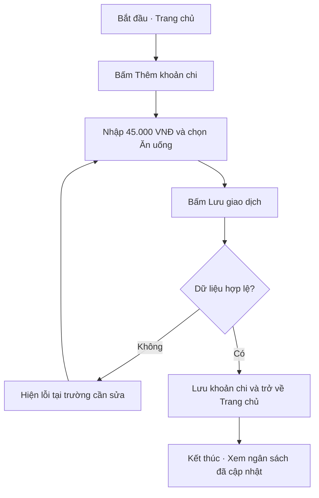
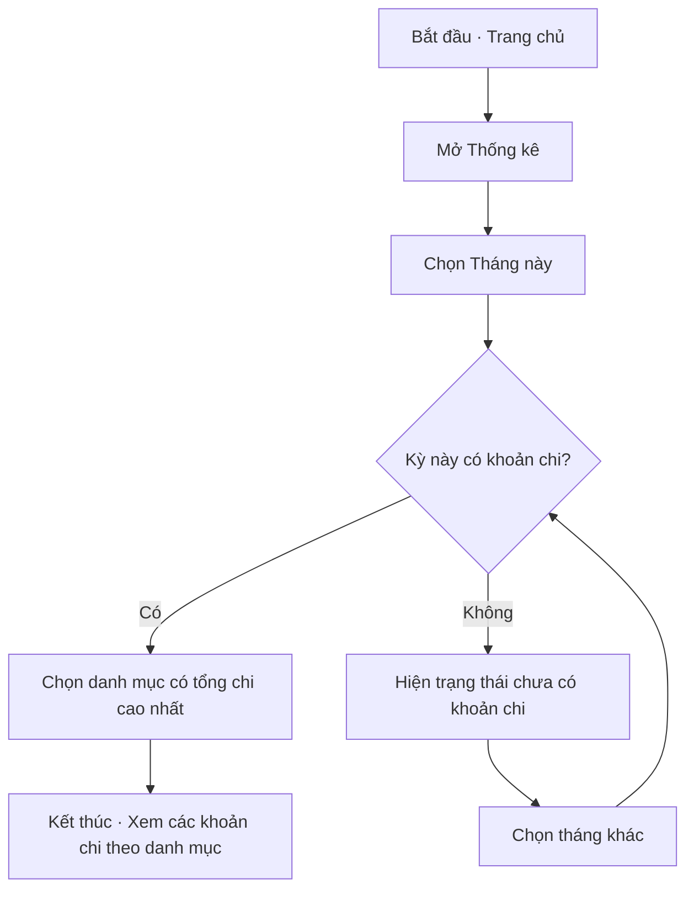
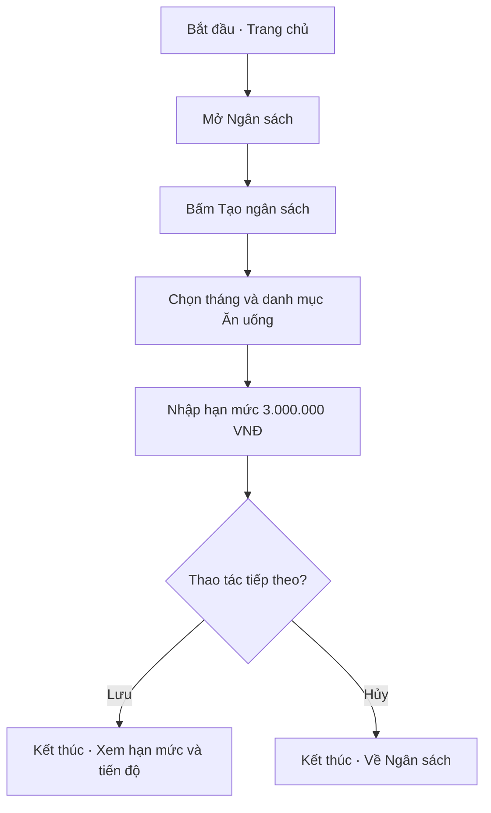

# User Flow — Expense Tracker

**Nhóm GR5 · Lab 2 · Phân tích UX**

## 1. Phạm vi thiết kế

Nhóm ưu tiên Nguyễn Minh Anh (P01), sinh viên cần ghi lại các khoản chi nhỏ ngay sau khi thanh toán. Luồng chính sử dụng tình huống trong persona: Minh Anh vừa ăn trưa hết **45.000 VNĐ** và muốn biết ngân sách tháng còn lại.

Hai luồng tiếp theo phục vụ Ngọc Linh (P02), người muốn xem chi tiêu theo danh mục, và Quốc Huy (P03), người muốn đặt hạn mức cho từng danh mục. Các lựa chọn điều hướng, dữ liệu mẫu và cách xử lý lỗi bên dưới là đề xuất cho prototype.

## 2. Kiến trúc thông tin

Thanh điều hướng dưới gồm **Trang chủ · Lịch sử · Thống kê · Ngân sách**. Các màn hình con mở từ màn hình cha và có nút Quay lại.

| Mã | Màn hình | Cấp điều hướng | Nội dung và thao tác chính |
|---|---|---|---|
| S01 | Trang chủ | Cấp chính, điểm vào mặc định | Xem tổng chi hôm nay và ngân sách tháng còn lại. Bấm **Thêm khoản chi** để mở S02. |
| S02 | Thêm giao dịch | Con của S01 | Mở sẵn loại **Khoản chi**. Nhập số tiền, chọn danh mục, ngày mặc định là hôm nay, ghi chú tùy chọn. |
| S03 | Lịch sử giao dịch | Cấp chính | Danh sách giao dịch theo ngày. Chạm một giao dịch để mở S04. |
| S04 | Chi tiết giao dịch | Con của S03 | Xem số tiền, loại giao dịch, danh mục, ngày và ghi chú. |
| S05 | Thống kê | Cấp chính | Xem tổng thu chi, biểu đồ theo danh mục và bộ lọc thời gian. Chạm danh mục để mở S06. |
| S06 | Chi tiêu theo danh mục | Con của S05 | Xem tổng chi và danh sách khoản chi của danh mục trong kỳ đã chọn. |
| S07 | Ngân sách | Cấp chính | Xem hạn mức, đã chi và còn lại theo tháng và danh mục. Bấm **Tạo ngân sách** để mở S08. |
| S08 | Tạo ngân sách danh mục | Con của S07 | Chọn tháng, danh mục và nhập hạn mức trước khi lưu. |

Tám mục trên là tám màn hình riêng. Thông báo, lỗi ngay dưới ô nhập và trạng thái trống nằm trong màn hình tương ứng.

## 3. UF-01 — Ghi khoản chi và kiểm tra ngân sách

- **Persona:** P01 — Nguyễn Minh Anh.
- **Bắt đầu:** Trang chủ, với ngân sách tháng đã được thiết lập.
- **Mục tiêu:** Lưu khoản ăn trưa 45.000 VNĐ vào danh mục Ăn uống.
- **Kết thúc:** Trang chủ hiển thị ngân sách còn lại đã giảm 45.000 VNĐ. Minh Anh có thể mở Lịch sử để kiểm tra khoản vừa lưu.
- **Nhánh lỗi và phục hồi:** Nếu số tiền trống hoặc không lớn hơn 0, hiển thị lỗi ngay dưới ô số tiền, giữ danh mục đã chọn và cho nhập lại. Nếu thiếu danh mục, đánh dấu ô danh mục và giữ số tiền đã nhập.

**Kiểm tra prototype**

1. Đo từ lúc giao Trang chủ cho người thử đến khi khoản chi được lưu. Mục tiêu là tối đa **15 giây** và người thử tự thao tác.
2. Dùng số liệu mẫu 1.200.000 VNĐ trước khi lưu. Sau khi lưu, người thử chỉ ra được số tiền còn lại **1.155.000 VNĐ** trên Trang chủ.
3. Người thử mở **Lịch sử**, chọn giao dịch vừa tạo và xác nhận đúng **45.000 VNĐ · Ăn uống**.

## 4. UF-02 — Xem danh mục chi nhiều nhất

- **Persona:** P02 — Trần Ngọc Linh.
- **Bắt đầu:** Trang chủ.
- **Mục tiêu:** Tìm danh mục có tổng chi cao nhất trong tháng và xem các khoản chi thuộc danh mục đó.
- **Kết thúc:** Màn hình Chi tiêu theo danh mục hiển thị đúng danh mục, tháng, tổng chi và danh sách giao dịch.
- **Nhánh thay thế:** Nếu tháng được chọn chưa có khoản chi, màn hình Thống kê hiển thị trạng thái trống. Linh đổi sang tháng khác bằng cùng bộ lọc.

**Kiểm tra prototype:** Với tháng có dữ liệu, người thử tự mở báo cáo trong tối đa 30 giây và xác định đúng danh mục có tổng chi lớn nhất. Tên danh mục và số tiền hiển thị bằng chữ để người thử đọc được ngay trên biểu đồ.

## 5. UF-03 — Đặt ngân sách cho danh mục Ăn uống

- **Persona:** P03 — Lê Quốc Huy.
- **Bắt đầu:** Trang chủ.
- **Mục tiêu:** Đặt hạn mức **3.000.000 VNĐ** cho Ăn uống trong tháng hiện tại.
- **Kết thúc:** Màn hình Ngân sách hiển thị hạn mức đã lưu cùng số đã chi và số còn lại của danh mục.
- **Nhánh thay thế:** Nếu Quốc Huy muốn hoãn thiết lập, chọn **Hủy** để trở về Ngân sách. Dữ liệu đang nhập được bỏ và không tạo ngân sách.

**Kiểm tra prototype:** Người thử tự tạo được hạn mức cho một danh mục trong tối đa 2 phút. Với dữ liệu mẫu đã chi 450.000 VNĐ trong tháng, màn hình hiển thị còn lại **2.550.000 VNĐ**.

## 6. Thứ tự dựng prototype

1. Nối **S01 → S02 → S01** để thử lưu khoản chi và sửa lỗi nhập liệu. Nối tiếp **S01 → S03 → S04** để kiểm tra giao dịch.
2. Nối **S01 → S05 → S06**, chuẩn bị một tháng có dữ liệu và một tháng trống.
3. Nối **S01 → S07 → S08 → S07**, chuẩn bị cả thao tác Lưu và Hủy.

Nguồn nội bộ: [persona.md](persona.md) và tài liệu Lab 2, mục yêu cầu về kiến trúc thông tin và luồng người dùng.
# User Flow — Expense Tracker

**Nhóm GR5 · Lab 2 · Phân tích UX**

## 1. Phạm vi thiết kế

Nhóm ưu tiên Nguyễn Minh Anh (P01), sinh viên cần ghi lại các khoản chi nhỏ ngay sau khi thanh toán. Luồng chính sử dụng tình huống trong persona: Minh Anh vừa ăn trưa hết **45.000 VNĐ** và muốn biết ngân sách tháng còn lại.

Hai luồng tiếp theo phục vụ Ngọc Linh (P02), người muốn xem chi tiêu theo danh mục, và Quốc Huy (P03), người muốn đặt hạn mức cho từng danh mục. Các lựa chọn điều hướng, dữ liệu mẫu và cách xử lý lỗi bên dưới là đề xuất cho prototype.

## 2. Kiến trúc thông tin

Thanh điều hướng dưới gồm **Trang chủ · Lịch sử · Thống kê · Ngân sách**. Các màn hình con mở từ màn hình cha và có nút Quay lại.

| Mã | Màn hình | Cấp điều hướng | Nội dung và thao tác chính |
|---|---|---|---|
| S01 | Trang chủ | Cấp chính, điểm vào mặc định | Xem tổng chi hôm nay và ngân sách tháng còn lại. Bấm **Thêm khoản chi** để mở S02. |
| S02 | Thêm giao dịch | Con của S01 | Mở sẵn loại **Khoản chi**. Nhập số tiền, chọn danh mục, ngày mặc định là hôm nay, ghi chú tùy chọn. |
| S03 | Lịch sử giao dịch | Cấp chính | Danh sách giao dịch theo ngày. Chạm một giao dịch để mở S04. |
| S04 | Chi tiết giao dịch | Con của S03 | Xem số tiền, loại giao dịch, danh mục, ngày và ghi chú. |
| S05 | Thống kê | Cấp chính | Xem tổng thu chi, biểu đồ theo danh mục và bộ lọc thời gian. Chạm danh mục để mở S06. |
| S06 | Chi tiêu theo danh mục | Con của S05 | Xem tổng chi và danh sách khoản chi của danh mục trong kỳ đã chọn. |
| S07 | Ngân sách | Cấp chính | Xem hạn mức, đã chi và còn lại theo tháng và danh mục. Bấm **Tạo ngân sách** để mở S08. |
| S08 | Tạo ngân sách danh mục | Con của S07 | Chọn tháng, danh mục và nhập hạn mức trước khi lưu. |

Tám mục trên là tám màn hình riêng. Thông báo, lỗi ngay dưới ô nhập và trạng thái trống nằm trong màn hình tương ứng.

## 3. UF-01 — Ghi khoản chi và kiểm tra ngân sách

- **Persona:** P01 — Nguyễn Minh Anh.
- **Bắt đầu:** Trang chủ, với ngân sách tháng đã được thiết lập.
- **Mục tiêu:** Lưu khoản ăn trưa 45.000 VNĐ vào danh mục Ăn uống.
- **Kết thúc:** Trang chủ hiển thị ngân sách còn lại đã giảm 45.000 VNĐ. Minh Anh có thể mở Lịch sử để kiểm tra khoản vừa lưu.
- **Nhánh lỗi và phục hồi:** Nếu số tiền trống hoặc không lớn hơn 0, hiển thị lỗi ngay dưới ô số tiền, giữ danh mục đã chọn và cho nhập lại. Nếu thiếu danh mục, đánh dấu ô danh mục và giữ số tiền đã nhập.

**Kiểm tra prototype**

1. Đo từ lúc giao Trang chủ cho người thử đến khi khoản chi được lưu. Mục tiêu là tối đa **15 giây** và người thử tự thao tác.
2. Dùng số liệu mẫu 1.200.000 VNĐ trước khi lưu. Sau khi lưu, người thử chỉ ra được số tiền còn lại **1.155.000 VNĐ** trên Trang chủ.
3. Người thử mở **Lịch sử**, chọn giao dịch vừa tạo và xác nhận đúng **45.000 VNĐ · Ăn uống**.

## 4. UF-02 — Xem danh mục chi nhiều nhất

- **Persona:** P02 — Trần Ngọc Linh.
- **Bắt đầu:** Trang chủ.
- **Mục tiêu:** Tìm danh mục có tổng chi cao nhất trong tháng và xem các khoản chi thuộc danh mục đó.
- **Kết thúc:** Màn hình Chi tiêu theo danh mục hiển thị đúng danh mục, tháng, tổng chi và danh sách giao dịch.
- **Nhánh thay thế:** Nếu tháng được chọn chưa có khoản chi, màn hình Thống kê hiển thị trạng thái trống. Linh đổi sang tháng khác bằng cùng bộ lọc.

**Kiểm tra prototype:** Với tháng có dữ liệu, người thử tự mở báo cáo trong tối đa 30 giây và xác định đúng danh mục có tổng chi lớn nhất. Tên danh mục và số tiền hiển thị bằng chữ để người thử đọc được ngay trên biểu đồ.

## 5. UF-03 — Đặt ngân sách cho danh mục Ăn uống

- **Persona:** P03 — Lê Quốc Huy.
- **Bắt đầu:** Trang chủ.
- **Mục tiêu:** Đặt hạn mức **3.000.000 VNĐ** cho Ăn uống trong tháng hiện tại.
- **Kết thúc:** Màn hình Ngân sách hiển thị hạn mức đã lưu cùng số đã chi và số còn lại của danh mục.
- **Nhánh thay thế:** Nếu Quốc Huy muốn hoãn thiết lập, chọn **Hủy** để trở về Ngân sách. Dữ liệu đang nhập được bỏ và không tạo ngân sách.

**Kiểm tra prototype:** Người thử tự tạo được hạn mức cho một danh mục trong tối đa 2 phút. Với dữ liệu mẫu đã chi 450.000 VNĐ trong tháng, màn hình hiển thị còn lại **2.550.000 VNĐ**.

## 6. Thứ tự dựng prototype

1. Nối **S01 → S02 → S01** để thử lưu khoản chi và sửa lỗi nhập liệu. Nối tiếp **S01 → S03 → S04** để kiểm tra giao dịch.
2. Nối **S01 → S05 → S06**, chuẩn bị một tháng có dữ liệu và một tháng trống.
3. Nối **S01 → S07 → S08 → S07**, chuẩn bị cả thao tác Lưu và Hủy.

Nguồn nội bộ: [persona.md](persona.md) và tài liệu Lab 2, mục yêu cầu về kiến trúc thông tin và luồng người dùng.
# User Flow — Expense Tracker

**Nhóm GR5 · Lab 2 · Phân tích UX**

## 1. Phạm vi thiết kế

Nhóm ưu tiên Nguyễn Minh Anh (P01), sinh viên cần ghi lại các khoản chi nhỏ ngay sau khi thanh toán. Luồng chính sử dụng tình huống trong persona: Minh Anh vừa ăn trưa hết **45.000 VNĐ** và muốn biết ngân sách tháng còn lại.

Hai luồng tiếp theo phục vụ Ngọc Linh (P02), người muốn xem chi tiêu theo danh mục, và Quốc Huy (P03), người muốn đặt hạn mức cho từng danh mục. Các lựa chọn điều hướng, dữ liệu mẫu và cách xử lý lỗi bên dưới là đề xuất cho prototype.

## 2. Kiến trúc thông tin

Thanh điều hướng dưới gồm **Trang chủ · Lịch sử · Thống kê · Ngân sách**. Các màn hình con mở từ màn hình cha và có nút Quay lại.

| Mã | Màn hình | Cấp điều hướng | Nội dung và thao tác chính |
|---|---|---|---|
| S01 | Trang chủ | Cấp chính, điểm vào mặc định | Xem tổng chi hôm nay và ngân sách tháng còn lại. Bấm **Thêm khoản chi** để mở S02. |
| S02 | Thêm giao dịch | Con của S01 | Mở sẵn loại **Khoản chi**. Nhập số tiền, chọn danh mục, ngày mặc định là hôm nay, ghi chú tùy chọn. |
| S03 | Lịch sử giao dịch | Cấp chính | Danh sách giao dịch theo ngày. Chạm một giao dịch để mở S04. |
| S04 | Chi tiết giao dịch | Con của S03 | Xem số tiền, loại giao dịch, danh mục, ngày và ghi chú. |
| S05 | Thống kê | Cấp chính | Xem tổng thu chi, biểu đồ theo danh mục và bộ lọc thời gian. Chạm danh mục để mở S06. |
| S06 | Chi tiêu theo danh mục | Con của S05 | Xem tổng chi và danh sách khoản chi của danh mục trong kỳ đã chọn. |
| S07 | Ngân sách | Cấp chính | Xem hạn mức, đã chi và còn lại theo tháng và danh mục. Bấm **Tạo ngân sách** để mở S08. |
| S08 | Tạo ngân sách danh mục | Con của S07 | Chọn tháng, danh mục và nhập hạn mức trước khi lưu. |

Tám mục trên là tám màn hình riêng. Thông báo, lỗi ngay dưới ô nhập và trạng thái trống nằm trong màn hình tương ứng.

## 3. UF-01 — Ghi khoản chi và kiểm tra ngân sách

- **Persona:** P01 — Nguyễn Minh Anh.
- **Bắt đầu:** Trang chủ, với ngân sách tháng đã được thiết lập.
- **Mục tiêu:** Lưu khoản ăn trưa 45.000 VNĐ vào danh mục Ăn uống.
- **Kết thúc:** Trang chủ hiển thị ngân sách còn lại đã giảm 45.000 VNĐ. Minh Anh có thể mở Lịch sử để kiểm tra khoản vừa lưu.
- **Nhánh lỗi và phục hồi:** Nếu số tiền trống hoặc không lớn hơn 0, hiển thị lỗi ngay dưới ô số tiền, giữ danh mục đã chọn và cho nhập lại. Nếu thiếu danh mục, đánh dấu ô danh mục và giữ số tiền đã nhập.

**Kiểm tra prototype**

1. Đo từ lúc giao Trang chủ cho người thử đến khi khoản chi được lưu. Mục tiêu là tối đa **15 giây** và người thử tự thao tác.
2. Dùng số liệu mẫu 1.200.000 VNĐ trước khi lưu. Sau khi lưu, người thử chỉ ra được số tiền còn lại **1.155.000 VNĐ** trên Trang chủ.
3. Người thử mở **Lịch sử**, chọn giao dịch vừa tạo và xác nhận đúng **45.000 VNĐ · Ăn uống**.

## 4. UF-02 — Xem danh mục chi nhiều nhất

- **Persona:** P02 — Trần Ngọc Linh.
- **Bắt đầu:** Trang chủ.
- **Mục tiêu:** Tìm danh mục có tổng chi cao nhất trong tháng và xem các khoản chi thuộc danh mục đó.
- **Kết thúc:** Màn hình Chi tiêu theo danh mục hiển thị đúng danh mục, tháng, tổng chi và danh sách giao dịch.
- **Nhánh thay thế:** Nếu tháng được chọn chưa có khoản chi, màn hình Thống kê hiển thị trạng thái trống. Linh đổi sang tháng khác bằng cùng bộ lọc.

**Kiểm tra prototype:** Với tháng có dữ liệu, người thử tự mở báo cáo trong tối đa 30 giây và xác định đúng danh mục có tổng chi lớn nhất. Tên danh mục và số tiền hiển thị bằng chữ để người thử đọc được ngay trên biểu đồ.

## 5. UF-03 — Đặt ngân sách cho danh mục Ăn uống

- **Persona:** P03 — Lê Quốc Huy.
- **Bắt đầu:** Trang chủ.
- **Mục tiêu:** Đặt hạn mức **3.000.000 VNĐ** cho Ăn uống trong tháng hiện tại.
- **Kết thúc:** Màn hình Ngân sách hiển thị hạn mức đã lưu cùng số đã chi và số còn lại của danh mục.
- **Nhánh thay thế:** Nếu Quốc Huy muốn hoãn thiết lập, chọn **Hủy** để trở về Ngân sách. Dữ liệu đang nhập được bỏ và không tạo ngân sách.

**Kiểm tra prototype:** Người thử tự tạo được hạn mức cho một danh mục trong tối đa 2 phút. Với dữ liệu mẫu đã chi 450.000 VNĐ trong tháng, màn hình hiển thị còn lại **2.550.000 VNĐ**.

## 6. Thứ tự dựng prototype

1. Nối **S01 → S02 → S01** để thử lưu khoản chi và sửa lỗi nhập liệu. Nối tiếp **S01 → S03 → S04** để kiểm tra giao dịch.
2. Nối **S01 → S05 → S06**, chuẩn bị một tháng có dữ liệu và một tháng trống.
3. Nối **S01 → S07 → S08 → S07**, chuẩn bị cả thao tác Lưu và Hủy.

